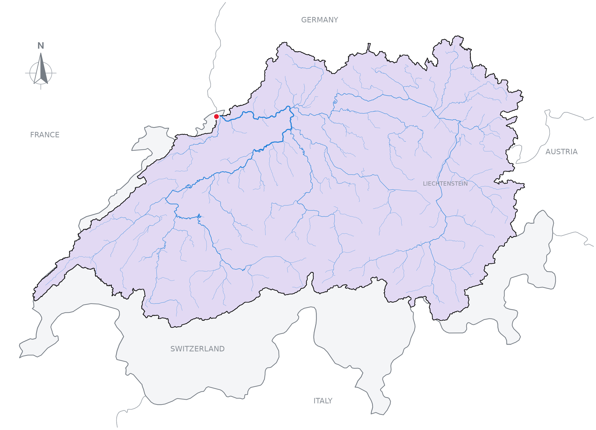

# Pourpoint

[](https://pypi.org/project/pourpoint/)
[](https://pypi.org/project/pourpoint/)
[](https://pourpoint-tools.github.io/)

Pourpoint is a Python package for delineating watersheds from existing hydrofabrics.
A watershed is the area of land that drains to a particular outlet. A hydrofabric
represents that landscape as connected sub-basins and rivers, sometimes accompanied
by flow-direction and flow-accumulation rasters.

Starting from a point, Pourpoint follows those connections upstream to collect the
contributing sub-basins. Where rasters are available, it can refine the watershed
cell by cell to resolve the land draining to the chosen outlet. You can work with
the resulting geometries in Python or export them with the river network to a
portable QGIS project.

Pourpoint reads hydrofabrics through [HydroFabric Exchange (HFX)](https://github.com/pourpoint-tools/hfx),
which packages their geometries, connections, attributes and available rasters.
The [concepts guide](https://pourpoint-tools.github.io/concepts/) explains how these
pieces fit together, from a point watershed to the upstream contributing area of a region.

## Install

Requires Python 3.13 or later. With [uv](https://docs.astral.sh/uv/), add Pourpoint
to your project.

```bash
uv add pourpoint
```

You can also install it with `pip install pourpoint`.

## Delineate the Rhine at Basel

The point at 47.5596° N, 7.5890° E lies on the Rhine in Basel, Switzerland. We will
use the public [GRIT hydrofabric](https://doi.org/10.1029/2024WR038308) to find its
watershed and save a QGIS project. Pourpoint reads the required data from the hosted
HFX bundle, so this example needs an internet connection.

A point chosen on a map can fall slightly beside the hydrofabric's river line.
We first select nearby rivers and snap the point to the nearest segment within
100 metres. Coordinates use longitude followed by latitude.

```python
from shapely.geometry import Point, box

import pourpoint as pp


dataset = "https://basin-delineations-public.upstream.tech/grit/hfx-v0.4.0/"
point = Point(7.5890, 47.5596)

with pp.HydroFabric(dataset) as fabric:
    nearby_rivers = pp.select_rivers(
        fabric=fabric,
        target=box(7.5790, 47.5496, 7.5990, 47.5696),
    )
    outlet = pp.snap(target=point, onto=nearby_rivers, radius=100)

    # Follow the sub-basin connections upstream from the outlet.
    subbasins = pp.select_upstream_subbasins(fabric=fabric, target=outlet)

    # Use native flow rasters to resolve the watershed within those sub-basins.
    refined = pp.refine(fabric=fabric, target=outlet, subbasins=subbasins)
    watershed = pp.merge(subbasins=refined.subbasins)

    # Select the supplied rivers inside the refined watershed.
    rivers = pp.select_rivers(fabric=fabric, target=watershed)

    bundle = pp.QGISBundle()
    bundle.add_result(refined)
    bundle.add_vector("watershed", watershed, crs="EPSG:4326")
    bundle.add_vector("rivers", rivers)
    bundle.add_vector("requested_point", point, crs="EPSG:4326")
    bundle.write("rhine-basel")
```

The code above generates the watershed shown below.

Open `rhine-basel/watershed.qgz` in QGIS. The folder contains the vector layers and
native raster subsets alongside the project. Keep the folder together when moving
or sharing it, and choose a new output folder for each export.



*Boundaries: [Natural Earth](https://www.naturalearthdata.com/). Their depiction implies no position on territorial status.*

### Use the combined workflow

When you only need the final result, `delineate` combines snapping, upstream
selection, refinement and merging. Using the same imports, dataset and point,
the following produces the same watershed and river geometries in a second bundle.

```python
with pp.HydroFabric(dataset) as fabric:
    nearby_rivers = pp.select_rivers(
        fabric=fabric,
        target=box(7.5790, 47.5496, 7.5990, 47.5696),
    )
    result = pp.delineate(
        fabric=fabric,
        target=point,
        snap_onto=nearby_rivers,
        radius=100,
        refine=True,
    )
    rivers = pp.select_rivers(fabric=fabric, target=result.subbasins)

    bundle = pp.QGISBundle()
    bundle.add_result(result)
    bundle.add_vector("rivers", rivers)
    bundle.add_vector("requested_point", point, crs="EPSG:4326")
    bundle.write("rhine-basel-combined")
```

`add_result` includes the merged watershed, individual sub-basin contributions,
outlet cell and raster subsets. River selection remains a separate step, so you
can choose which network to include.

## Documentation

The [documentation](https://pourpoint-tools.github.io/) develops the concepts and
workflows illustrated here.

- [Getting started](https://pourpoint-tools.github.io/getting-started/) covers datasets, coordinates and caching.
- [Concepts](https://pourpoint-tools.github.io/concepts/) explains watershed selection and raster refinement.
- [Operations](https://pourpoint-tools.github.io/operations/) covers batches, river selection and portable output.
- [API reference](https://pourpoint-tools.github.io/reference/operations/) describes the operations and their returned results.

## Acknowledgements and data rights

GRIT is the work of Michel Wortmann, Louise Slater, Laurence Hawker, Yinxue Liu and
Jeffrey Neal. We thank them for making their hydrography available, and
**Alden Keefe Samson at Upstream Tech for hosting GRIT** for public access.
See the [GRIT paper](https://doi.org/10.1029/2024WR038308) and
[data publication](https://zenodo.org/records/17435232) for citation and source details.

Pourpoint's code is licensed under [MIT](LICENSE). GRIT data and derived outputs
carry **CC BY-NC 4.0** terms. Follow the source dataset's attribution and reuse
conditions when sharing a watershed, map or QGIS bundle.

## Development

From a checkout, install the development dependencies and run the checks with uv.

```bash
uv sync --group dev
uv run python -m pytest
uv run ruff format --check src tests
uv run ruff check src tests
uv run ty check src
uv build
```

See [AGENTS.md](AGENTS.md) for project conventions and
[building the documentation](docs/building.md) for the local documentation workflow.

The Rust comparison baseline is
[CooperBigFoot/pourpoint at `60e3d6e383546ea6ed20e68fe4d77959c816a48c`](https://github.com/CooperBigFoot/pourpoint/tree/60e3d6e383546ea6ed20e68fe4d77959c816a48c).
In a checkout of that repository, inspect it with
`git show 60e3d6e383546ea6ed20e68fe4d77959c816a48c:crates/core/src/engine.rs`.
