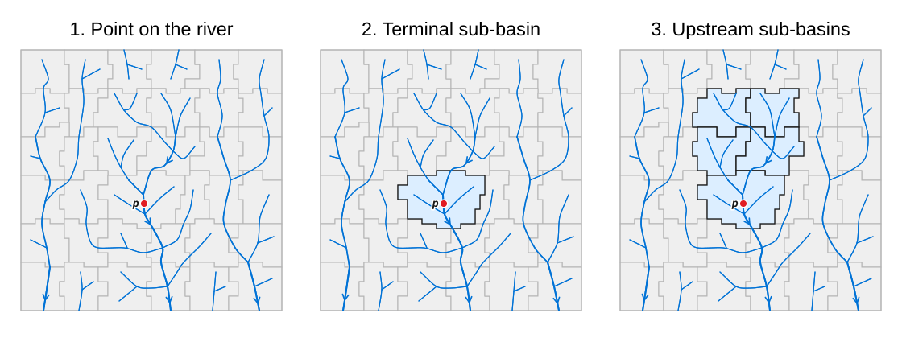
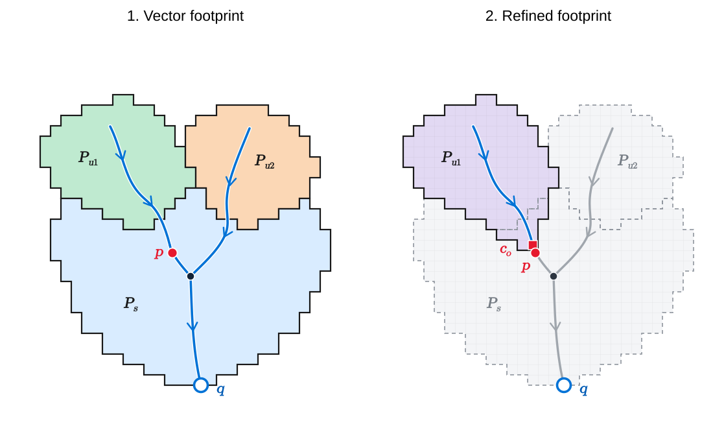

# Watersheds and upstream contributing area

## Hydrofabrics: the datasets Pourpoint operates on

A **hydrofabric** describes how a landscape drains. The USGS defines it as
“a dataset containing a network of connected representations of rivers, lakes,
and catchments” ([USGS, *Progress Toward a Reference Hydrologic Geospatial Fabric*](https://waterdata.usgs.gov/blog/hydrofabric/)).

In Pourpoint, we understand a hydrofabric as a dataset **tiling the landscape
into sub-basins**, describing their downstream connections, and providing the
river network alongside auxiliary data, when available, such as the
flow-direction and flow-accumulation rasters used to produce it.

Pourpoint operates on these existing datasets; it does not construct the
hydrofabric from elevation data. It reads them through
[HydroFabric Exchange (HFX)](hfx/index.md), the format that packages their
geometries, connectivity, attributes and available rasters.
Examples of such datasets include [GRIT](https://doi.org/10.1029/2024WR038308),
[MERIT-Basins](https://www.reachhydro.org/home/params/merit-basins), derived from
[MERIT Hydro](https://doi.org/10.1029/2019WR024873), and
[TDX-Hydro](https://doi.org/10.22541/essoar.171629686.65893579/v1).

## Delineating a watershed from a point

In Pourpoint, we understand a **watershed** as the area of land that drains to a
specified outlet point.

### Snap the point to a river

A hydrofabric represents rivers with vector lines. Those lines simplify the
river's course and may not coincide exactly with a surveyed location or a point
chosen on a map. A point intended to represent a river outlet can therefore
fall beside the dataset's river line.

We recommend snapping the requested point to the hydrofabric's river network,
especially when raster refinement will follow. Snapping places the point on
the nearest supplied river segment within a search radius. It helps align the
request with the dataset's representation of drainage; refinement will then
search nearby for an outlet cell. See [`snap`](reference/operations.md#pourpoint.snap)
for the operation and its parameters.

Snapping is optional: Pourpoint can also delineate from the original point.
We use $p$ for the point after snapping, or for the unchanged point when snapping
is not requested. In the first panel below, $p$ lies on the river network.

*Locate the point, identify its terminal sub-basin, then select the sub-basins
upstream of it. Conceptual schematic.*

### Identify the terminal unit

Pourpoint locates the sub-basin containing $p$. This is the starting place for
our upstream search, and we call it the **terminal unit**, denoted by $t$.
The second panel highlights it in blue. If $p$ lies exactly on a shared boundary,
we need a way to choose between the touching sub-basins: Pourpoint arbitrarily
assigns it to the one whose numerical ID is smallest.

We use $b$ for a sub-basin and $P_b$ for its polygon. In particular, $t$ is the
sub-basin associated with our point $p$, and $P_t$ is its polygon.

### Collect upstream sub-basins

Starting at $t$, follow the hydrofabric's connections upstream. First find the
sub-basins draining directly into $t$, then those draining into them, and
continue until no new sub-basins remain. The third panel shows the selected
units, including $t$ itself.

Mathematically, we write $b \to t$ when sub-basin $b$ drains directly into $t$,
and $b \to^* t$ when it reaches $t$ through any number of downstream connections.
We allow zero connections, so $t \to^* t$. The selected set is

$$
\mathcal B_t = \{b \mid b \to^* t\}.
$$

Here $b$ denotes a sub-basin, and the arrow describes the hydrofabric's
connectivity between sub-basins. Thus $\mathcal B_t$ contains $t$ and every
sub-basin that drains into it, directly or indirectly.

Combining their polygons gives the **vector footprint**:

$$
M = \bigcup_{b \in \mathcal B_t} P_b.
$$

The union symbol means combine the polygons of all selected sub-basins,
counting overlapping land once. This is the result of
[`select_upstream_subbasins`](reference/operations.md#pourpoint.select_upstream_subbasins),
which also forms the vector-selection stage of
[`delineate`](reference/operations.md#pourpoint.delineate).

## Refining a point watershed

No matter where $p$ lies within its terminal unit, vector delineation selects
the same sub-basins and produces the same footprint. The figure below illustrates
why this can include land that does not drain to the requested point.

*Left: vector footprint. Right: raster-refined footprint. Conceptual schematic.
The terminal polygon is labelled $P_s$ in this figure; it corresponds to $P_t$
in the text.*

In the left panel, both upstream units $u_1$ and $u_2$ drain into the terminal
unit. However, $p$ lies on the left branch, above the junction. Water from $u_2$
joins that branch **downstream of $p$**, so it does not drain to $p$. Selecting
whole sub-basins includes $u_2$ because it drains to the terminal unit, not
because it drains to the particular point we chose inside it.

Even a point on the main stem can lie upstream of the sub-basin's declared
outlet, labelled $q$. Land draining into the river between that point and $q$
also belongs to the vector footprint but not to the point's watershed.

This is where sub-basin size matters. We can informally think of it as the
hydrofabric's **vector resolution**: whole polygons are the smallest pieces
we can select. Smaller sub-basins allow finer distinctions between outlets;
there is no single fixed size when the polygons have different areas.
Some datasets also offer several levels of subdivision. The USGS
[Watershed Boundary Dataset](https://www.usgs.gov/national-hydrography/watershed-boundary-dataset),
for example, organizes hydrologic units into a nested hierarchy identified by
Hydrologic Unit Codes (HUCs).

When the hydrofabric provides flow-direction and flow-accumulation rasters,
[`refine`](reference/operations.md#pourpoint.refine) can resolve contributing
land cell by cell instead. Pourpoint reads the rasters over the whole vector
footprint $M$ and masks out cells outside it. The light-gray grid in the right
panel represents this working area. A cell belongs to the mask when its centre
falls within $M$; we denote this set of cells by $\mathcal G_M$.

### Choose the outlet cell

The **flow-accumulation raster** records the upstream contribution to each cell,
in the dataset's declared units, such as a cell count or drainage area.
Pourpoint examines a small window around $p$. Among cells inside the mask with
valid accumulation and direction values, it selects the one with the greatest
accumulation. We call this the **outlet cell**, $c_o$.

The default search window is $3 \times 3$ cells. This is an engineering choice
for a local adjustment, with the expectation that users will usually snap their
point to the river network first. It is configurable, not a universal optimum:
a larger window can select a different branch near a junction. See
[refinement conventions](operations.md#selection-and-refinement-conventions).

### Trace upstream cells

The **flow-direction raster** records which neighbouring cell receives each
cell's flow. Pourpoint currently supports the D8 model, in which that neighbour
is one of the eight surrounding cells. Datasets can encode those eight directions
with different numbers; Pourpoint supports ESRI, TauDEM and unsigned or signed
GRASS encodings. See [raster encodings](rasters.md#results-and-semantics).

Let $d(c)$ denote the downstream cell receiving flow from cell $c$, when its
direction defines one. For example, $d(a)=b$ means that cell $a$ drains directly
into cell $b$. To find cells upstream of $b$, we look for neighbours whose
downstream destination is $b$.

Starting with the outlet, we build successive upstream sets:

$$
C_0 = \{c_o\},
\qquad
C_{k+1} = \{c \in \mathcal G_M \mid d(c) \in C_k\}.
$$

The next set contains cells inside the mask that drain directly into a cell in
the current set. Thus $C_1$ contains cells one flow step upstream of the outlet,
$C_2$ contains cells two steps upstream, and so on. Cells with no defined
downstream neighbour do not satisfy this condition.

Combining these sets gives all contributing cells, including the outlet:

$$
\mathcal C = \bigcup_{k=0}^{\infty} C_k.
$$

The infinity symbol expresses “all upstream steps.” In execution, Pourpoint
does not revisit cells it has already found and stops when no new cells remain.
Accumulation is used to select the outlet; direction determines the upstream
connections. An upstream cell can therefore contribute even if its accumulation
value is missing.

### Construct the refined footprint

Let $\operatorname{footprint}(c)$ be the polygon occupied by raster cell $c$.
We combine these cell footprints and clip them to the vector footprint:

$$
W_{\mathrm{refined}}(p) = M \cap \bigcup_{c \in \mathcal C} \operatorname{footprint}(c).
$$

The intersection with $M$ clips boundary cells to the original vector footprint.
In the right panel, the pale-purple refined area includes land draining through $u_1$ and
part of the terminal unit, but excludes the right-hand branch through $u_2$.

??? note "Refinement assumes vector–raster consistency"
    In the two-panel figure, $q$ is the terminal unit's **declared outlet**:
    the place where drainage leaves that sub-basin. It is different from our
    requested outlet $p$, which can lie farther upstream within the unit.

    Let $W_R(q)$ be the watershed obtained from the flow-direction raster at
    the cell corresponding to $q$. Masking refinement to $M$ assumes

    $$
    M \equiv W_R(q).
    $$

    We mean equivalent drainage coverage at raster resolution, not identical
    pixel and vector boundaries. Refining at the declared outlet $q$ should
    recover the drainage area represented by the vector footprint.

    If the selected outlet's raster drainage reaches $q$, its contributing
    area is contained in that larger watershed:

    $$
    W_R(p) \subseteq W_R(q) \equiv M.
    $$

    This is the assumption that makes restricting the trace to $M$ safe.
    It has not yet been tested on the available datasets with rasters.
    Successful refinement does not verify it: a masked trace cannot discover
    contributing land outside the mask. How to check or declare consistency
    remains open; [issue #38](https://github.com/pourpoint-tools/pourpoint/issues/38)
    records the deferred checking utility.

## Generalizing from a point to a region

Instead of asking which land drains to one point, we can ask which land drains
to **any point in a target geometry**: a lake, a river reach, or a region.
We call this its **upstream contributing area**. Think of it as the hydrological
extent of the target—the land that contributes drainage to it.

Let $R$ be the target geometry, and let $W(p)$ denote the watershed of a point
$p$. Then

$$
U(R) = \bigcup_{p \in R} W(p).
$$

Here $p$ ranges over every spatial point belonging to $R$, including its interior
and boundary. Imagine placing an outlet at each of those points and combining
their watersheds. That combined area is $U(R)$. Land within the target is included:
it already reaches the target without travelling downstream.

A point watershed is the single-point case:

$$
U(\{p\}) = W(p).
$$

### Vector delineation of a region

For a regional target, we select every sub-basin whose polygon shares any part
of $R$. This includes polygons **wholly inside the region**, polygons crossing
its boundary, and polygons touching its boundary. We call this set of terminal
units $T_R$:

$$
T_R = \{b \mid P_b \cap R \neq \varnothing\}.
$$

The condition means that the polygon and the region have a nonempty intersection;
it does not require their boundaries to cross.

For each terminal unit $t$, we collect $\mathcal B_t$, including $t$ itself.
We then combine the selected sets and their polygons:

$$
\mathcal B_R = \bigcup_{t \in T_R} \mathcal B_t,
\qquad
M_R = \bigcup_{b \in \mathcal B_R} P_b.
$$

Every unit in $T_R$ therefore remains in the result, alongside its upstream
contributors. $U(R)$ is the conceptual contributing area, while $M_R$ is its
representation using whole sub-basin polygons. Pourpoint currently uses this
vector representation for regions; raster refinement is available for point
outlets.
